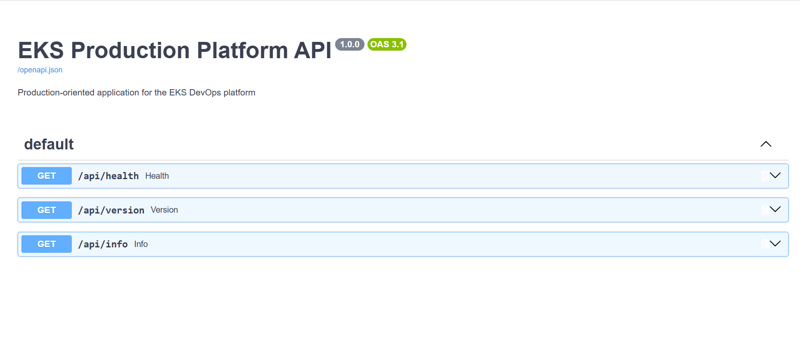
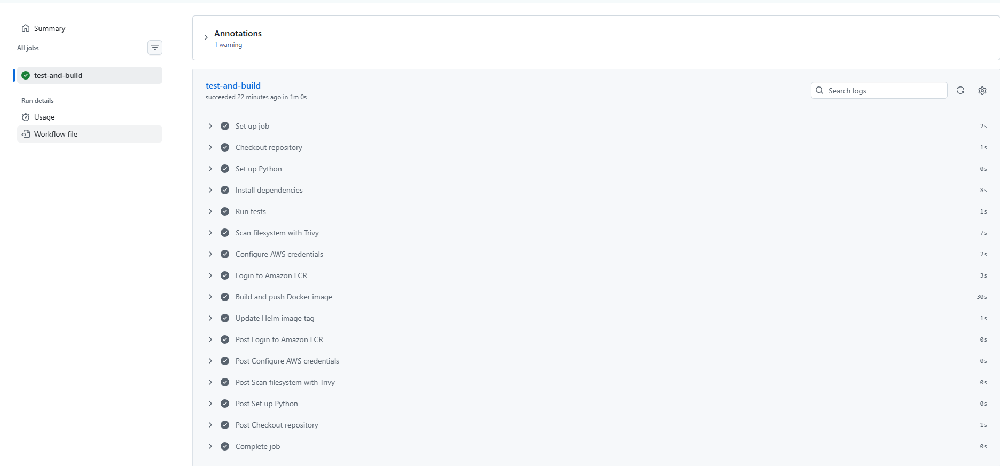
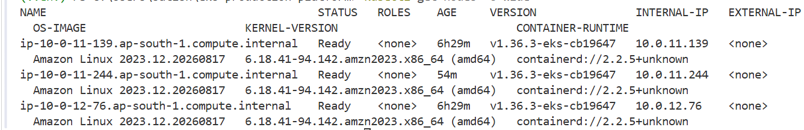
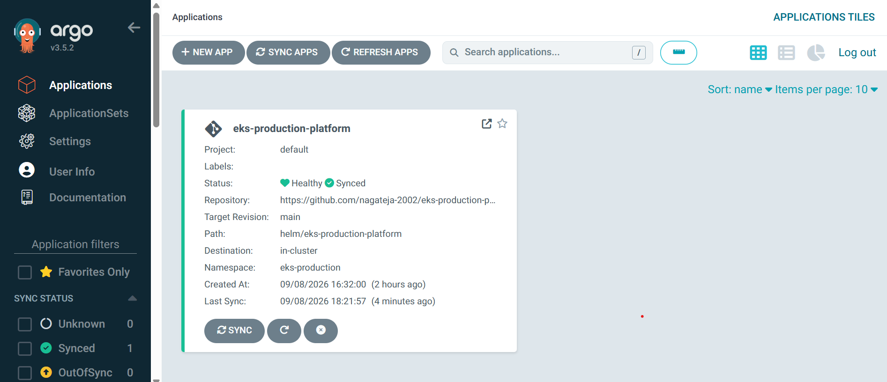
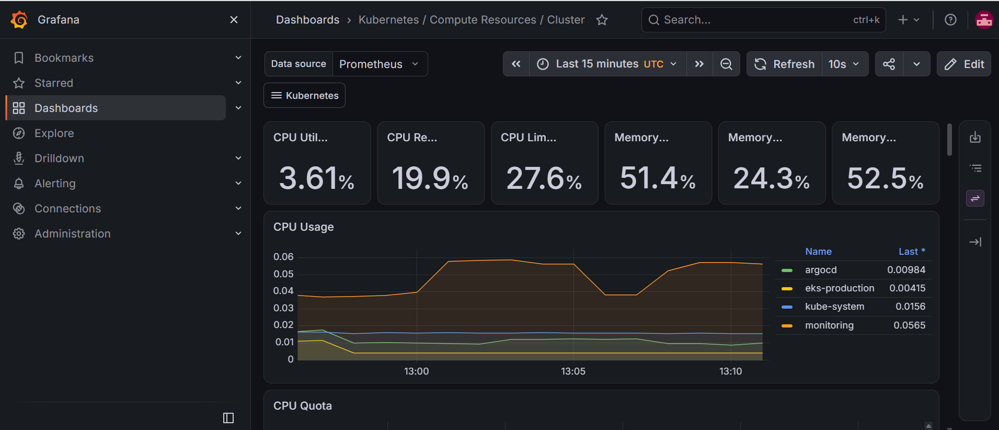

# EKS Production-Oriented Platform

A hands-on cloud-native platform engineering lab that brings together AWS infrastructure provisioning, Kubernetes application deployment, CI automation, GitOps, and basic workload reliability practices.

> **Project scope:** This is a portfolio / learning project, not a claim that the setup is production-hardened. Review costs, security settings, and configuration before deploying it in an AWS account.

## What the project demonstrates

- **Infrastructure as Code:** Terraform configuration for AWS networking, IAM, Amazon EKS, and a managed node group.
- **Containerized application:** A small FastAPI service with a Dockerfile and application tests.
- **Kubernetes operations:** Deployment, Service, namespace, and PodDisruptionBudget manifests.
- **Helm packaging:** A Helm chart with Deployment, Service, HorizontalPodAutoscaler, and PodDisruptionBudget templates.
- **GitOps:** An Argo CD Application manifest for reconciling Kubernetes resources from Git.
- **CI automation:** A GitHub Actions workflow in `.github/workflows/ci.yml`.
- **Observability and validation:** Screenshots documenting the application, CI workflow, EKS nodes, Argo CD, and Grafana.

## Architecture at a glance

```text
Developer changes
      |
      v
GitHub repository -----> GitHub Actions CI
      |                       |
      |                       +--> application checks / image workflow
      v
Argo CD Application
      |
      v
Amazon EKS cluster
      |
      +--> Kubernetes Deployment / Pods
      +--> Service
      +--> Helm chart resources
      +--> HPA and PodDisruptionBudget
      |
      v
Grafana / observability view
```

The diagram shows the intended flow. Exact automation and deployment behavior depends on the current workflow, Argo CD configuration, cluster configuration, and image settings in the repository.

## Repository layout

| Path | Purpose |
|---|---|
| `app/` | FastAPI application, Dockerfile, dependencies, and tests |
| `terraform/` | AWS provider, networking, IAM, EKS cluster, and node-group infrastructure |
| `kubernetes/` | Kubernetes namespace, Deployment, Service, and PodDisruptionBudget manifests |
| `helm/eks-production-platform/` | Helm chart and templates for the application workload |
| `argocd/application.yaml` | Argo CD Application definition |
| `.github/workflows/ci.yml` | GitHub Actions CI workflow |
| `docs/screenshots/` | Visual evidence of selected project components |

## Prerequisites

- An AWS account with permission to create and manage the resources defined in the Terraform configuration
- AWS CLI configured for the intended account
- Terraform installed
- Docker installed and running
- kubectl installed
- Helm installed
- An EKS-compatible Kubernetes context when running cluster commands
- Argo CD installed and configured if you want to test the GitOps portion

Check the active AWS identity before provisioning:

```bash
aws sts get-caller-identity
aws configure list
```

## Review before deploying

1. Read the Terraform files in `terraform/` and identify the resources, region, node sizing, and network configuration they create.
2. Confirm the AWS account and region are the ones you intend to use.
3. Check the Terraform plan for resource count and estimated cost implications.
4. Verify image names, repository URLs, namespaces, and chart values before applying Kubernetes changes.
5. Avoid committing AWS credentials, kubeconfig files, tokens, or other secrets.

## Terraform workflow

Run from the Terraform directory:

```bash
cd terraform
terraform fmt -check
terraform init
terraform validate
terraform plan
```

Review the plan carefully before applying it. Provisioning an EKS cluster, worker nodes, and networking resources can incur AWS charges.

`terraform apply` is intentionally not included as a copy-and-run command here: inspect and approve the plan for your own account first. When you finish experimenting, review the resources and destroy only the resources created for this lab.

## Application and Kubernetes workflow

Inspect the application and tests in `app/`, then build and test locally:

```bash
docker build -t eks-production-platform:local ./app
```

Run the application tests from the `app/` directory, matching the workflow's working directory:

```bash
cd app
python -m pip install -r requirements.txt
python -m pytest -q
cd ..
```

The tests import the local `app` package, so running from the repository's `app/` directory keeps the import path consistent with CI.

Before applying manifests, verify the Kubernetes context:

```bash
kubectl config current-context
kubectl get nodes
```

Review the manifest files, namespaces, and image references before applying anything. For a cluster you control, useful post-deployment checks include:

```bash
kubectl get deployments,pods,services -A
kubectl get events -A --sort-by=.metadata.creationTimestamp
kubectl rollout status deployment/<deployment-name> -n <namespace>
```

Replace the placeholders with the actual Deployment and namespace defined in the selected manifest or Helm values. Do not run these commands against a company or production cluster unless you are explicitly authorized to do so.

## Helm and GitOps

The chart is under `helm/eks-production-platform/`. Inspect the values and templates before installing:

```bash
helm lint helm/eks-production-platform
helm template eks-production-platform helm/eks-production-platform
```

The Argo CD Application manifest is at `argocd/application.yaml`. Before using it, verify the source repository, target revision, path, destination cluster, namespace, and sync options. Argo CD must already be installed and have access to the repository and destination cluster.

## CI workflow

The GitHub Actions workflow is `.github/workflows/ci.yml`. On pushes and pull requests targeting `main`, it installs dependencies, runs tests, and performs a Trivy filesystem scan. On a push to `main`, it also uses GitHub OIDC to assume the configured AWS IAM role, builds and pushes the application image to Amazon ECR, and commits the image tag update to the Helm values file. Review the workflow's role ARN, trust policy, IAM permissions, and repository permissions before using the pattern in another account. A workflow configuration alone does not prove that a hosted run passed; inspect the [Actions tab](https://github.com/nagateja-2002/eks-production-platform/actions) for the latest result.

## Screenshots

### FastAPI application



### GitHub Actions CI/CD pipeline



### Amazon EKS nodes



### Argo CD GitOps deployment



### Grafana observability



## Validation checklist

Use this checklist to record results from your own environment:

- [ ] `terraform fmt -check` completed successfully
- [ ] `terraform validate` completed successfully
- [ ] Terraform plan reviewed for intended resources and cost
- [ ] Application tests passed
- [ ] Container image built successfully
- [ ] Kubernetes workload became available
- [ ] Service reachability verified
- [ ] Helm chart lint/template checks passed
- [ ] Argo CD application synchronized and healthy, if configured
- [ ] Latest hosted GitHub Actions run reviewed

Do not mark a check as complete until you have run it and confirmed its output.

## Safety and cleanup

- Use a dedicated sandbox AWS account or environment where possible.
- Apply least-privilege IAM and do not publish credentials or sensitive cluster data.
- Confirm the account, region, and Terraform plan before creating or deleting infrastructure.
- Remove the lab resources when finished to avoid ongoing charges. Use Terraform from the same working directory and state that created the resources, and inspect the destroy plan before approving it.

## What I learned / practiced

- Structuring infrastructure code for an AWS networking and EKS environment
- Packaging and deploying a containerized application to Kubernetes
- Defining workload resources through Kubernetes manifests and Helm
- Connecting Git-based configuration to Argo CD GitOps workflows
- Using CI automation and observable deployment evidence to support troubleshooting

## License

See [LICENSE](LICENSE).
